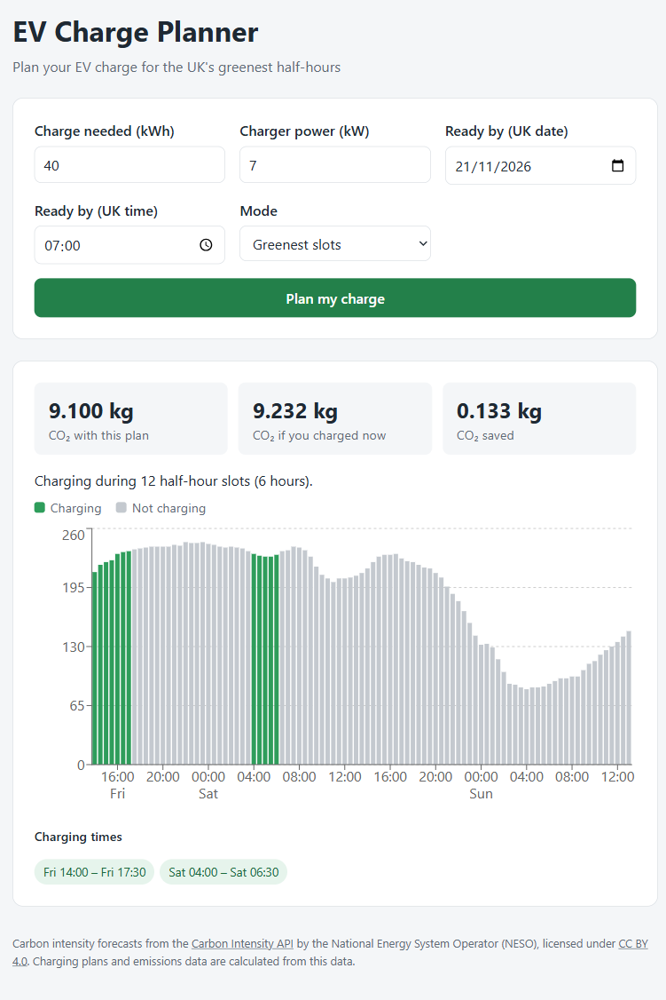

# EV Charge Planner

[](https://github.com/edosim/ev-charge-planner/actions/workflows/ci.yml)

EV Charge Planner is a live app for planning carbon-aware charging times for electric vehicles (EVs) in the UK, based on the Carbon Intensity API (NESO) forecast of CO₂ emitted by the grid per kWh in the next 48h.


**Live demo:** [ev-charge-planner-742443010251.europe-west1.run.app](https://ev-charge-planner-742443010251.europe-west1.run.app)




## What it does

- Fetches the UK's carbon intensity 48-hour forecast from the [Carbon Intensity API](https://carbonintensity.org.uk/).
- Picks the greenest half-hour slots (*discrete mode*) or the greenest continuous block of half-hour slots (*continuous mode*) before your deadline.
- Shows the picked slots, the CO₂ emissions saved compared to charging now and warns you if there isn't enough time for a full charge.

## Results

In September 2026, EV Charge Planner would have reduced emissions by about a quarter. Check out the analysis, including its limitations [here](analysis/README.md).

## How it works

1. The browser loads a page from a single container running a FastAPI server on Google Cloud Run. The server contains the React page and the API.
2. After submitting the form, the charge needed, charger power, deadline (UK date and time) and mode are sent to the `/schedule` endpoint.
3. FastAPI checks the deadline, fetches the 48-hour forecast from the Carbon Intensity API, and drops the half-hour already in progress. It then determines the best half-hours and computes the total forecast emissions for the plan, the total forecast emissions for charging from the next half-hour and their difference.
4. The page shows a chart of the plan, the emissions, the times of the charge and warns if there are not enough slots for a full charge.


## Tech stack

| Area      | Tools                                                     |
| --------  | --------------------------------------                     |
| Backend   | Python 3.11, FastAPI, httpx, Pydantic                     |
| Frontend  | React, Vite, TypeScript, Recharts                         |
| Testing   | pytest, mypy, Vitest, ESLint                                    |
| Delivery  | Docker, GitHub Actions, Google Cloud Run    |

## Design decisions


- **Planning:** discrete mode picks the greenest half-hours, continuous mode finds the greenest unbroken block with a sliding window. Plans start at the next half-hour, and the last slot may be partial.
- **Validation:** Pydantic models check every request and forecast before the planner sees them, with the same limits at the endpoint and in the request model.
- **Time:** deadlines are entered in UK time and handled in UTC, with clock changes handled explicitly.
- **Testability:** the HTTP client and the current time are injected, so tests run against a fake API with a fixed clock.
- **Deployment:** one container serves both the API and the page, on Cloud Run with no permissions and scaling to zero.

The detailed description of each is in [docs/design-decisions.md](docs/design-decisions.md).


## Repository structure

```
ev-charge-planner/
├── backend/        # FastAPI app (api.py), planner, schemas and pytest tests
├── frontend/       # React + TypeScript page and Vitest tests
├── analysis/       # Savings analysis and tests
├── deploy/         # Artifact Registry clean-up policy
├── docs/           # App screenshot and design decisions
├── Dockerfile      # Builds the page, then the Python app
└── .github/        # CI workflow
```

## Running locally

### Backend

``` bash
cd backend
pip install -r requirements-dev.txt
uvicorn api:app --reload
```

Go to http://localhost:8000/docs to see the endpoint.

### Frontend

Start the backend first: the dev server forwards `/schedule` requests to it.

```bash
cd frontend
npm install
npm run dev
```

Go to http://localhost:5173.

### Docker

```bash
docker build -t ev-charge-planner .
docker run --rm -p 8080:8080 ev-charge-planner
```
Go to http://localhost:8080.


## Tests

### Backend

```bash
cd backend
mypy
pytest
```

### Frontend
```bash
cd frontend
npm run lint
npm run test
```

GitHub Actions runs these on pushes to `main` and on pull requests, and checks that the Docker image can be built.

## Future features

- Regional forecasts.
- Price-aware charging.
- Cache the forecast API.

## Forecast data

Carbon intensity forecasts from the [Carbon Intensity API](https://carbonintensity.org.uk/) by the National Energy System Operator (NESO), licensed under [CC BY 4.0](https://creativecommons.org/licenses/by/4.0/). Charging plans and emissions data are calculated from this data.
