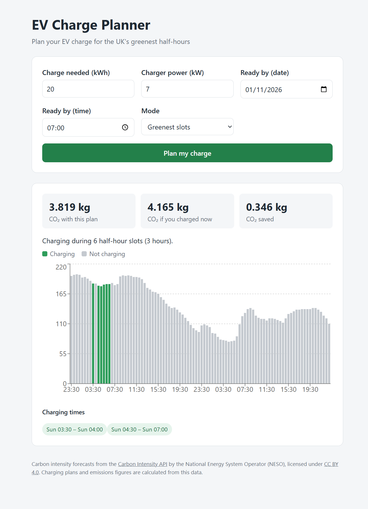

# EV Charge Planner

[](https://github.com/edosim/ev-charge-planner/actions/workflows/ci.yml)

EV Charge Planner is a live app for planning carbon-aware charging times for electric vehicles (EVs) in the UK, based on the Carbon Intensity API (NEPO) forecast of CO₂ emitted by the grid per kWh in the next 48h.


**Live demo:** [ev-charge-planner-742443010251.europe-west1.run.app](https://ev-charge-planner-742443010251.europe-west1.run.app)


<!--  -->

## What it does

- Fetches the UK's carbon intensity 48-hour forecast from the [Carbon Intensity API](https://carbonintensity.org.uk/).
- Picks the greenest half-hour slots (*discrete mode*) or the greenest continous block of half-hour slots (*continuous mode*) before your deadline.
- Shows the picked slots, the CO₂ emissions saved compared to charging now and warns you if there isn't enough time for a full charge.

## Results

In September 2026, EV Charge Planner would have reduced emissions by 25%. Check out the analysis [here](analysis/README.md).

## How it works

1. The browser loads a page from a single container running a FastAPI server on Google Cloud Run. The server contains the React page and the API.
2. Afer submitting, the form, the charge needed, power, date, time and chosen mode are sent to the the `\schedule` endpoint.
3. FastAPI fetches the 48-hour forecast from the Carbon Intensity API, determines the best half-hours and computes the total emissions forecasted for the plan, the total emissions forecasted for charging now and their difference.
4. The page shows a chart of the plan, the emission data, the times of the charge and warns if there are not enough slots for a full charge.


## Tech stack

| Area      | Tools                                                     |
| --------  | --------------------------------------                     |
| Backend   | Python 3.11, FastAPI, httpx, Pydantic                     |
| Frontend  | React, Vite, TypeScript, Recharts                         |
| Testing   | pytest, Vitest, ESLint                                    |
| Delivery  | Docker, GitHub Actions, Google Cloud Run    |


## Repository structure

```
ev-charge-planner/
├── backend/        # FastAPI app, planner and pytest tests
├── frontend/       # React + TypeScript page and Vitest tests
├── analysis/       # Savings analysis
├── Dockerfile      # Builds the page, then the Python app
└── .github/        # CI workflow
```

## Running locally

### Backend

``` bash
cd backend
pip install -r requirements-dev.txt
uvicorn api:app --reload
```

Go to http://localhost:8000/docs to see the endpoint

### Frontend

```bash
cd frontend
npm install
npm run dev
```

Go to http://localhost:5173.

### Docker

```bash
docker build -t ev-charge-planner .
docker run --rm -p 8080:8080 ev-charge-planner
```
Open http://localhost:8080.


## Tests

### Backend

```bash
cd backend
pytest
```

### Frontend
```bash
cd frontend
npm run lint
npm run test
```

GitHub Actions runs these on every push and checks that the Docker image can be built.

## Forecast data

Carbon intensity forecasts from the [Carbon Intensity API](https://carbonintensity.org.uk/) by the National Energy System Operator (NESO), licensed under [CC BY 4.0](https://creativecommons.org/licenses/by/4.0/). Charging plans and emissions data are calculated from this data.
